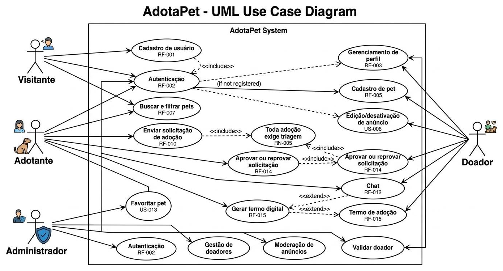
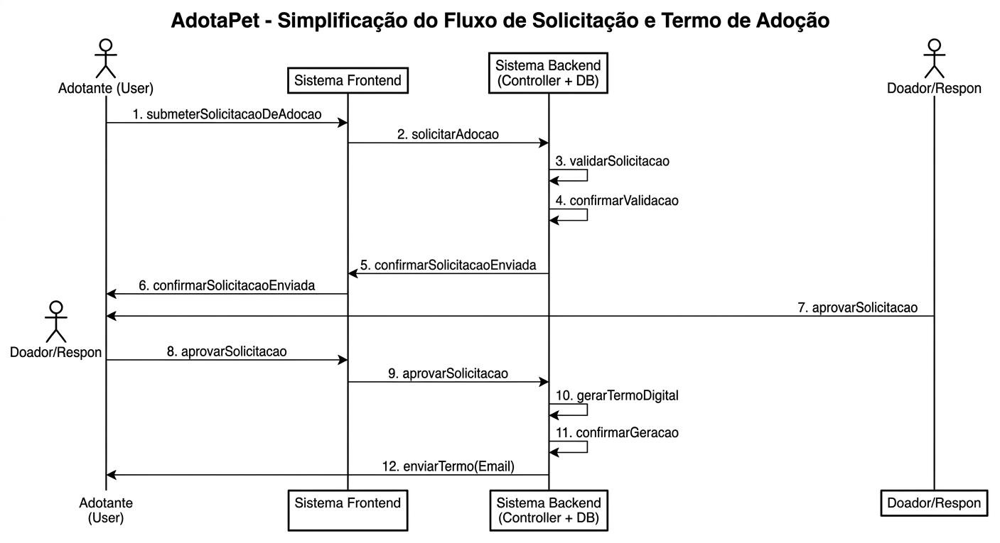
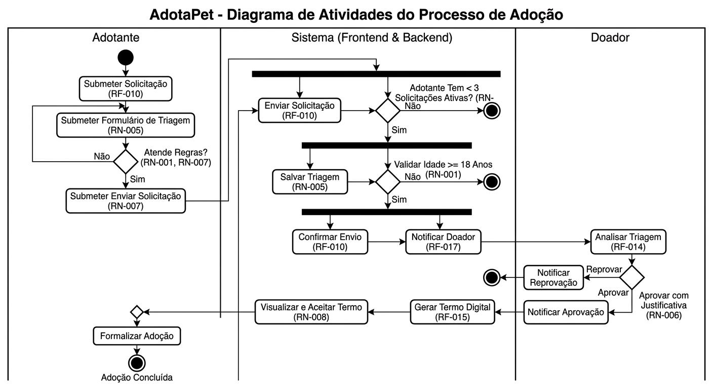

# 🐾 AdotaPet

> Plataforma web que conecta animais resgatados a adotantes responsáveis, centralizando divulgação, triagem, solicitação, aprovação e acompanhamento da adoção de cães e gatos.

**Universidade Federal do Amazonas – UFAM** 
**Instituto de Ciências Exatas e Tecnologia – ICET** 
**Curso:** Engenharia de Software – Itacoatiara/AM 
**Equipe:** Bruno Henrique de Sousa Gomes 
**Data:** Novembro/2026 

---

## 📑 Sumário

1. [Introdução](#1-introdução)
   - 1.1. [Descrição Geral do Software](#11-descrição-geral-do-software)
   - 1.2. [Descrição dos Usuários](#12-descrição-dos-usuários)
2. [Requisitos Gerais do Software](#2-requisitos-gerais-do-software)
   - 2.1. [Requisitos Funcionais](#21-requisitos-funcionais)
   - 2.2. [Requisitos Não Funcionais](#22-requisitos-não-funcionais)
   - 2.3. [Regras de Negócio](#23-regras-de-negócio)
3. [Diagramas UML](#3-diagramas-uml)
   - 3.1. [Diagramas de Casos de Uso](#31-diagramas-de-casos-de-uso)
   - 3.2. [Diagramas de Sequência](#32-diagramas-de-sequência)
   - 3.3. [Diagramas de Atividades](#33-diagramas-de-atividades)
4. [Uso de Inteligência Artificial](#4-uso-de-inteligência-artificial)

---

## 1. Introdução

Este documento apresenta, de forma resumida, a especificação do sistema **AdotaPet**, destinado à divulgação, busca, triagem e gerenciamento de adoções responsáveis de cães e gatos. Ele serve como artefato de comunicação entre as partes interessadas do projeto (equipe de desenvolvimento, ONGs, protetores e adotantes).

**Abreviações usadas:**

| Sigla | Significado |
|-------|-------------|
| RF | Requisito Funcional |
| RNF | Requisito Não Funcional |
| RN | Regra de Negócio |
| UC | Caso de Uso |
| UML | Unified Modeling Language |
| LGPD | Lei Geral de Proteção de Dados |
| ONG | Organização não governamental de proteção animal |

### 1.1. Descrição Geral do Software

O **AdotaPet** é uma aplicação web cujo objetivo é conectar animais resgatados a adotantes responsáveis. O sistema surge da necessidade de organizar e dar visibilidade ao processo de adoção animal, reduzindo a informalidade, o abandono e a devolução de animais. A plataforma atua apenas como **intermediadora** entre doadores/ONGs e adotantes, **sem comercializar animais**.

#### ✅ O que o sistema inclui

- Cadastro de usuários: adotantes, ONGs, abrigos e protetores independentes
- Cadastro e gerenciamento de pets disponíveis para adoção
- Busca e filtragem por espécie, porte, idade, cidade, temperamento, castração, vacinação etc.
- Visualização detalhada do pet, com fotos, histórico e requisitos do doador
- Sistema de favoritos e notificações
- Solicitação de adoção com formulário de triagem
- Chat entre adotante e doador
- Agendamento de entrevista ou visita
- Aprovação, reprovação ou lista de espera da solicitação
- Emissão de termo de adoção digital
- Registro de pós-adoção e acompanhamento
- Moderação de anúncios, denúncias e usuários
- Relatórios gerenciais e indicadores

#### ❌ O que o sistema NÃO inclui (nesta versão)

- Venda ou compra de animais
- Serviços veterinários completos
- Transporte de animais
- Processamento de pagamentos
- Prontuário clínico veterinário

#### 🔌 Fronteira do sistema (serviços externos)

- Serviço de autenticação e login
- Armazenamento de imagens
- Serviço de e-mail e notificações push
- API de mapas para localização aproximada
- Serviços de denúncia e conformidade com a LGPD

#### 📌 Premissas e restrições

**Premissas**
- Os usuários possuem acesso à internet e navegador atualizado.
- As ONGs e protetores fornecem informações verídicas sobre os pets.
- O processo de adoção segue a legislação local e as políticas da organização.
- Os dados pessoais são tratados conforme a LGPD.

**Restrições**
- Prazo e orçamento definidos no plano de projeto.
- Tecnologias e infraestrutura previamente selecionadas.
- Necessidade de acessibilidade e responsividade.
- Conformidade com normas de proteção animal e proteção de dados.

### 1.2. Descrição dos Usuários

| Ator | Descrição | Necessidades principais | Permissões | Nível técnico |
|------|-----------|-------------------------|------------|---------------|
| **Visitante** | Usuário não autenticado que navega pela plataforma | Buscar pets, visualizar detalhes e entender o processo de adoção | Visualizar pets, filtros e informações públicas | Baixo |
| **Adotante** | Usuário cadastrado que deseja adotar um pet | Favoritar, solicitar adoção, conversar com o doador, acompanhar status | Criar conta, editar perfil, enviar solicitação, chat, avaliar pós-adoção | Baixo/Médio |
| **Doador/Responsável** | ONG, abrigo ou protetor independente que cadastra pets | Gerenciar anúncios, receber solicitações, triar adotantes, registrar adoção | CRUD de pets, gerenciar solicitações, chat, emitir termo, pós-adoção | Médio |
| **Administrador** | Responsável pela moderação e gestão da plataforma | Moderar conteúdo, gerenciar usuários, resolver denúncias, gerar relatórios | Acesso total, moderação, relatórios, configurações | Médio/Alto |

---

## 2. Requisitos Gerais do Software

Esta seção consolida os requisitos de alto nível do AdotaPet, classificados em Requisitos Funcionais (RF), Requisitos Não Funcionais (RNF) e Regras de Negócio (RN), seguindo princípios de verificabilidade, rastreabilidade e não ambiguidade (IEEE 830 / ISO/IEC/IEEE 29148).

### 2.1. Requisitos Funcionais

| ID | Requisito | Descrição | Atores | Prioridade |
|----|-----------|-----------|--------|:----------:|
| RF-001 | Cadastro de usuário | Permitir cadastro de adotante, doador/ONG e administrador, com validação de e-mail e senha forte | Visitante | Alta |
| RF-002 | Autenticação | Realizar login, logout e recuperação de senha com sessão segura | Todos | Alta |
| RF-003 | Gerenciamento de perfil | Manter dados cadastrais, preferências, consentimento LGPD e configurações de privacidade | Usuários autenticados | Alta |
| RF-004 | Gestão de doadores | Cadastrar e validar ONGs, abrigos e protetores independentes | Administrador, Doador | Média |
| RF-005 | Cadastro de pet | Registrar cão ou gato com espécie, raça, porte, idade, sexo, castração, vacinação, temperamento, fotos e localização | Doador | Alta |
| RF-006 | Edição/desativação de anúncio | Editar, pausar, reativar ou encerrar anúncio de pet | Doador | Alta |
| RF-007 | Busca e filtros | Buscar pets por espécie, porte, idade, cidade, castração, vacinação, temperamento e outros critérios | Visitante, Adotante | Alta |
| RF-008 | Visualização detalhada | Exibir ficha completa do pet, galeria de fotos, histórico e requisitos do doador | Visitante, Adotante | Alta |
| RF-009 | Favoritos | Favoritar, desfavoritar e gerenciar lista de pets favoritos | Adotante | Média |
| RF-010 | Solicitação de adoção | Enviar formulário de triagem para um pet específico | Adotante | Alta |
| RF-011 | Acompanhamento de solicitação | Consultar status: enviada, em análise, aprovada, reprovada ou lista de espera | Adotante, Doador | Alta |
| RF-012 | Chat | Trocar mensagens entre adotante e doador dentro da plataforma | Adotante, Doador | Média |
| RF-013 | Agendamento | Agendar entrevista ou visita entre adotante e doador | Adotante, Doador | Baixa |
| RF-014 | Decisão do doador | Aprovar, reprovar ou colocar solicitação em lista de espera, com justificativa | Doador | Alta |
| RF-015 | Termo de adoção | Gerar termo digital de adoção e registrar aceite das partes | Adotante, Doador | Alta |
| RF-016 | Pós-adoção | Registrar acompanhamento pós-adoção e emitir lembretes periódicos | Adotante, Doador | Média |
| RF-017 | Notificações | Enviar notificações por e-mail e push sobre status, mensagens e lembretes | Sistema | Alta |
| RF-018 | Denúncias | Permitir denúncia de anúncios, usuários ou condutas inadequadas | Usuários autenticados | Média |
| RF-019 | Moderação | Analisar denúncias, remover conteúdo irregular e suspender usuários | Administrador | Alta |
| RF-020 | Relatórios e dashboards | Gerar indicadores de adoções, pets cadastrados, taxa de aprovação e tempo médio de adoção | Administrador, Doador | Média |
| RF-021 | Geolocalização | Exibir pets próximos por cidade ou raio de distância | Visitante, Adotante | Baixa |
| RF-022 | Histórico | Manter histórico de adoções, solicitações e interações | Todos | Média |
| RF-023 | Exportação de dados | Exportar relatórios em CSV ou PDF | Administrador | Baixa |
| RF-024 | Privacidade e LGPD | Gerenciar consentimento, exclusão, portabilidade e anonimização de dados | Usuários, Administrador | Alta |
| RF-025 | Integrações | Integrar com serviços de e-mail, push, armazenamento de imagens e mapas | Sistema | Média |

### 2.2. Requisitos Não Funcionais

| ID | Categoria | Requisito | Métrica |
|----|-----------|-----------|---------|
| RNF-001 | Usabilidade | Interface intuitiva, responsiva e de fácil aprendizagem | SUS ≥ 80; tarefas principais concluídas em até 3 cliques |
| RNF-002 | Desempenho | Tempo de resposta adequado para navegação e busca | 95% das requisições ≤ 2s; buscas ≤ 3s |
| RNF-003 | Disponibilidade | Alta disponibilidade da plataforma | 99,5% de uptime mensal; manutenções programadas |
| RNF-004 | Segurança | Autenticação, autorização e proteção contra vulnerabilidades | RBAC, TLS 1.3, hash Argon2/bcrypt, OWASP Top 10 |
| RNF-005 | Privacidade/LGPD | Tratamento de dados pessoais conforme a legislação | Consentimento explícito, anonimização, direito ao esquecimento |
| RNF-006 | Acessibilidade | Acesso inclusivo a todos os usuários | WCAG 2.1 nível AA; navegação por teclado e leitor de tela |
| RNF-007 | Responsividade | Funcionamento em dispositivos móveis e desktop | Mobile-first; Chrome, Firefox, Edge e Safari; telas ≥ 320px |
| RNF-008 | Escalabilidade | Suportar crescimento de usuários e anúncios | 10.000 usuários simultâneos; escala horizontal |
| RNF-009 | Manutenibilidade | Código modular, documentado e testável | Cobertura de testes ≥ 80%; documentação atualizada |
| RNF-010 | Portabilidade | Execução em ambientes distintos | Docker/Kubernetes; suporte multi-SO e nuvem |
| RNF-011 | Auditoria | Registro de ações críticas | Logs com usuário, data/hora, IP e operação |
| RNF-012 | Backup e recuperação | Política de backup e restauração | RPO ≤ 24h; RTO ≤ 4h |
| RNF-013 | Compatibilidade | Integração com APIs e serviços externos | REST/JSON; webhooks; e-mail, push e mapas |
| RNF-014 | Localização | Suporte a idioma e formatos regionais | pt-BR inicial; preparado para i18n |
| RNF-015 | Confiabilidade | Integridade e consistência dos dados | Transações ACID; integridade referencial |
| RNF-016 | Mídia | Otimização de imagens e carregamento | Lazy loading, compressão e CDN |

### 2.3. Regras de Negócio

| ID | Regra | Descrição | Requisitos impactados |
|----|-------|-----------|-----------------------|
| RN-001 | Idade mínima | O adotante deve ter 18 anos ou mais | RF-001, RF-010 |
| RN-002 | Proibição de venda | É proibida a comercialização de animais na plataforma | RF-005, RF-019 |
| RN-003 | Veracidade das informações | O doador deve fornecer informações verídicas e fotos reais do animal | RF-005, RF-018 |
| RN-004 | Saúde do animal | O status de vacinação e castração deve ser informado; caso negativo, exigir justificativa | RF-005 |
| RN-005 | Triagem obrigatória | Toda adoção exige preenchimento de formulário de triagem | RF-010 |
| RN-006 | Decisão do doador | A aprovação, reprovação ou lista de espera é de responsabilidade do doador, com justificativa | RF-014 |
| RN-007 | Limite de solicitações | O adotante pode manter no máximo 3 solicitações ativas simultaneamente | RF-010 |
| RN-008 | Termo de adoção | A adoção só se formaliza após o aceite digital do termo | RF-015 |
| RN-009 | Pós-adoção | O acompanhamento pós-adoção ocorre em 3, 6 e 12 meses, podendo ser configurável | RF-016 |
| RN-010 | Devolução | A devolução do animal deve ser registrada e justificada na plataforma | RF-016 |
| RN-011 | Denúncias | Denúncias devem ser analisadas em até 48 horas úteis | RF-018, RF-019 |
| RN-012 | LGPD | Dados pessoais só podem ser tratados com consentimento e finalidade específica | RF-003, RF-024 |
| RN-013 | Moderação | Anúncios duplicados, falsos ou irregulares serão removidos | RF-019 |
| RN-014 | Guarda responsável | O adotante assume responsabilidade pela guarda e bem-estar do animal | RF-015 |
| RN-015 | Validação institucional | Cadastros de ONGs e abrigos devem ser validados pela administração | RF-004 |

---

## 3. Diagramas UML

### 3.1. Diagramas de Casos de Uso

#### Diagrama geral

#### Especificações dos Casos de Uso

##### UC-01 – Cadastro de Usuário

| Campo | Descrição |
|-------|-----------|
| **Ator principal** | Visitante |
| **Atores secundários** | Sistema de e-mail (notificação) |
| **Pré-condições** | O visitante não possui cadastro ativo na plataforma |
| **Pós-condições** | Usuário cadastrado no banco de dados e apto a realizar autenticação |
| **Rastreabilidade** | RF-001, RN-001, RN-012, US-001 |

| Ações do ator | Ações do sistema |
|---------------|------------------|
| 1. Acessar a tela de cadastro | |
| | 2. Exibir formulário de cadastro |
| 3. Informar dados obrigatórios (nome, e-mail, senha, data de nascimento) | |
| 4. Clicar no botão "Cadastrar" | |
| | 5. Validar dados e verificar inexistência de e-mail duplicado |
| | 6. Criar conta com status "Ativo" |
| | 7. Enviar e-mail de confirmação |
| | 8. Exibir mensagem de sucesso e redirecionar para o login |

**Fluxos alternativos**
- **FA-01:** E-mail duplicado → bloquear cadastro
- **FA-02:** Idade inferior a 18 anos → bloquear cadastro (RN-001)
- **FA-03:** Campos obrigatórios não preenchidos → exibir erro

##### UC-02 – Favoritar Pet

| Campo | Descrição |
|-------|-----------|
| **Ator principal** | Adotante |
| **Atores secundários** | Nenhum |
| **Pré-condições** | O adotante deve estar autenticado e visualizando a ficha detalhada de um pet |
| **Pós-condições** | Pet adicionado ou removido da lista de favoritos do adotante |
| **Rastreabilidade** | RF-009, US-013 |

| Ações do ator | Ações do sistema |
|---------------|------------------|
| 1. Clicar no ícone/botão "Favoritar" | |
| | 2. Registrar a associação entre o ID do adotante e o ID do pet |
| | 3. Atualizar o ícone visualmente para indicar que o pet foi favoritado |
| | 4. Exibir mensagem de confirmação rápida (tooltip/toast) |

**Fluxos alternativos**
- **FA-01:** Desfavoritar → se já estiver favoritado, remover a associação
- **FA-02:** Sessão expirada → redirecionar para o login

##### UC-03 – Buscar e Filtrar Pets

| Campo | Descrição |
|-------|-----------|
| **Ator principal** | Visitante, Adotante |
| **Atores secundários** | Nenhum |
| **Pré-condições** | Nenhuma (acesso público) |
| **Pós-condições** | Lista de pets exibida em tela conforme os critérios de busca |
| **Rastreabilidade** | RF-007, RNF-002, US-011 |

| Ações do ator | Ações do sistema |
|---------------|------------------|
| 1. Acessar a página de busca | |
| | 2. Exibir filtros de busca (espécie, porte, idade, cidade, temperamento) |
| 3. Aplicar filtros desejados | |
| 4. Clicar em "Buscar" | |
| | 5. Processar a consulta no banco de dados |
| | 6. Retornar a lista paginada de pets que atendem aos critérios |
| | 7. Exibir os cards dos pets com foto, nome e informações resumidas |

**Fluxos alternativos**
- **FA-01:** Sem resultados → exibir mensagem sugerindo ampliar os critérios
- **FA-02:** Tempo de resposta ≤ 3s (RNF-002)

### 3.2. Diagramas de Sequência

#### Fluxo de Solicitação e Termo de Adoção

**Como funciona o fluxo**

1. **Submissão da solicitação (RF-010):** o adotante preenche o formulário de triagem obrigatório (RN-005) e envia. O frontend encaminha a solicitação ao backend (Controller).
2. **Validação das regras de negócio:** o backend verifica **RN-001** (idade ≥ 18 anos) e **RN-007** (máximo de 3 solicitações ativas). Se alguma regra falhar, o erro é devolvido ao usuário.
3. **Gravação e confirmação:** se as validações forem bem-sucedidas, a solicitação é salva com status **"Enviada"** e a confirmação retorna ao adotante.
4. **Decisão do doador (RF-014):** após analisar a triagem, o doador aprova a solicitação e o backend atualiza o status para **"Aprovada"**.
5. **Geração do termo (RF-015):** o sistema gera automaticamente o termo de adoção em PDF com assinatura digital, grava no banco e envia o link por e-mail ao adotante (RF-017).
6. **Aceite (RN-008):** a adoção só se formaliza quando o termo é aceito digitalmente.

### 3.3. Diagramas de Atividades

#### Processo de Adoção

---

## 4. Uso de Inteligência Artificial

Por transparência, registro aqui como ferramentas de IA generativa foram utilizadas na elaboração desta documentação. A IA atuou como **apoio**, e todo o conteúdo foi revisado pelo autor.

| Item | Descrição |
|------|-----------|
| **Ferramenta utilizada** | Claude (Anthropic) |
| **Para que foi usada** | Organizar o conteúdo do trabalho de modelagem de requisitos na estrutura do README; formatar tabelas e sumário |
| **O que NÃO foi feito pela IA** | A definição dos requisitos (RF, RNF, RN), as histórias de usuário, os casos de uso e os diagramas originais são do trabalho de modelagem desenvolvido pelo autor |
| **Revisão humana** | O autor conferiu o texto com o documento original e ajustou o conteúdo antes da publicação |
| **Limitações** | O conteúdo gerado depende do documento fornecido; por isso, a conferência com o trabalho original é feita pelo autor |

---

## 🧭 Rastreabilidade

Cada requisito, regra de negócio e caso de uso deste documento mantém referência cruzada por ID (RF, RNF, RN, UC, US), o que permite acompanhar a cobertura dos requisitos desde a regra de negócio até o diagrama que a implementa.

## 👤 Autor

**Bruno Henrique de Sousa Gomes** – Engenharia de Software, UFAM/ICET
